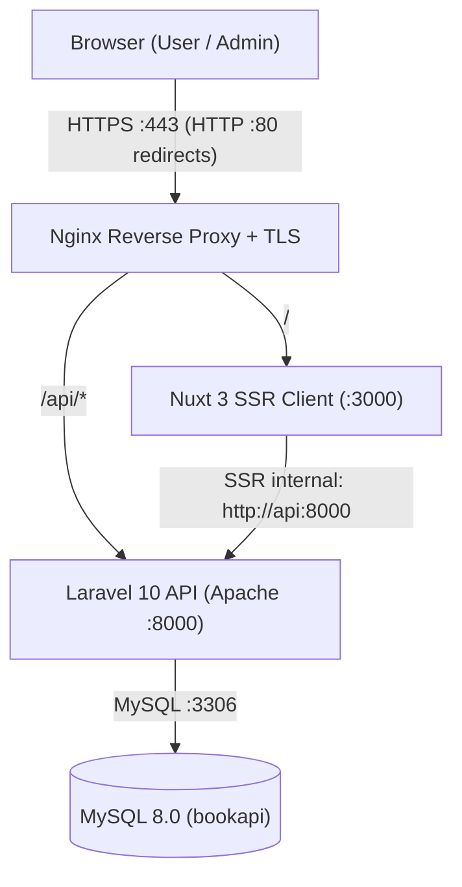
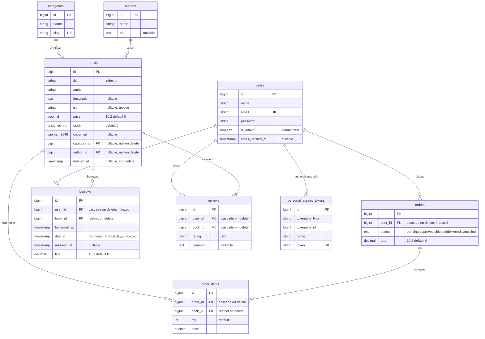
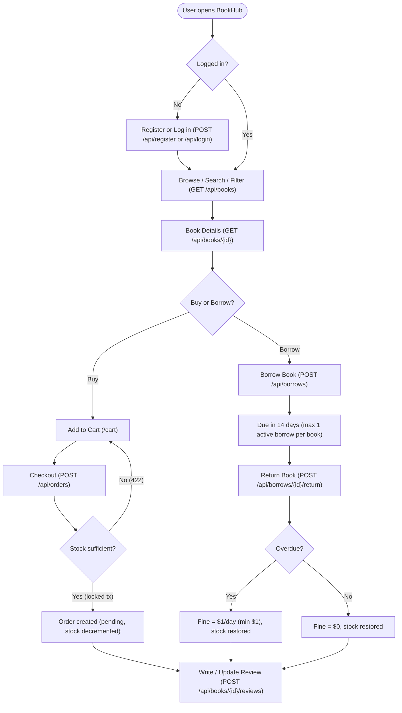
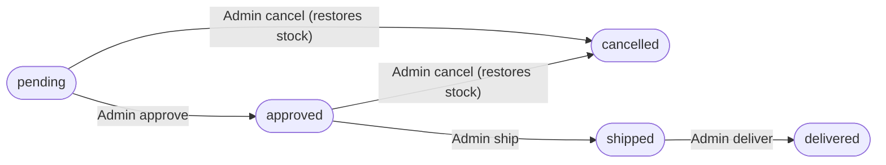
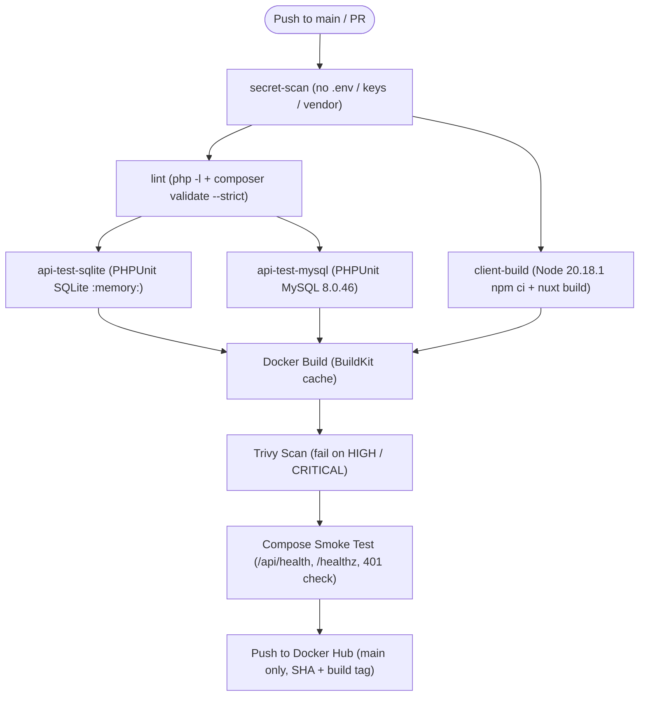

# BookHub — Full-Stack Bookstore & Library Platform

BookHub is a production-hardened, full-stack bookstore and library platform built with **Laravel 10**, **Nuxt 3**, **MySQL 8.0**, **Nginx (TLS reverse proxy)**, **Docker Compose**, and **GitHub Actions CI/CD**.

## Features

- **Book Catalog & Discovery:** Paginated catalog with full search (escaped `LIKE`), category/author filters, sorting, book details, ratings average, and reviews.
- **Shopping Cart & Atomic Orders:** Cart persisted in `localStorage`, transactional order checkout (`DB::transaction` + `lockForUpdate` sorted by `book_id` to prevent race conditions/deadlocks), and strict order status transitions (`pending → approved → shipped → delivered` or `cancelled`, restoring stock automatically).
- **Library Borrowing & Fines:** 14-day borrowing window, one active borrow per user per book, atomic return flow with overdue fine calculation (`$1/day`, minimum `$1` once overdue).
- **Reviews & Security:** One review per user per book (`updateOrCreate`), API Resources redacting reviewer email/admin flags on public endpoints, Sanctum bearer tokens (7-day expiration), auth rate limiting, and non-assignable `is_admin` role.
- **Admin Dashboard:** Manage books (`POST/PUT/DELETE`), categories, authors, order statuses, borrows, and live platform stats (`GET /api/admin/stats`).

---

## System Architecture



---

## Database Schema (ERD)



---

## Application Flowcharts

### User Journey (Browse, Buy, Borrow, Review)



### Order Status Lifecycle



### CI/CD Pipeline



---

## Stack & Pinned Versions

| Component | Version |
| --------- | ------- |
| PHP / API | `php:8.2.36-apache` (Laravel 10, Sanctum) |
| Composer | `composer:2.8.4` |
| Database | `mysql:8.0.46` |
| Client | `node:20.18.1-alpine` (Nuxt 3, Vue 3) |
| Reverse Proxy | `nginx:1.27.4-alpine` |

---

## Getting Started (After Cloning)

### Prerequisites

- **Docker** and **Docker Compose v2**
- **Git** and **OpenSSL** (for local self-signed TLS certs; on Windows use Git Bash or WSL for `.sh` scripts)
- *(Optional, for running PHPUnit outside Docker)* PHP 8.2+ with `sqlite3` and Composer

### Step 1 — Clone the repository

```bash
git clone https://github.com/Mahmoud6601/bookhub-platform.git
cd bookhub-platform
```

### Step 2 — Configure environment & secrets

The stack enforces fail-fast secrets (`DB_PASSWORD`, `MYSQL_ROOT_PASSWORD`, `APP_KEY`) and refuses to start without them:

```bash
cp .env.example .env
```

Generate a valid Laravel `APP_KEY`:
- **Without local PHP:**
  ```bash
  echo "base64:$(openssl rand -base64 32)"
  ```
- **Or with PHP/Composer:**
  ```bash
  cd api && composer install && php artisan key:generate --show && cd ..
  ```

Edit `.env` in the repository root and set:
- `DB_PASSWORD` (strong password for the `app` database user)
- `MYSQL_ROOT_PASSWORD` (strong root password for MySQL)
- `APP_KEY` (the `base64:...` string generated above)

### Step 3 — Generate local self-signed TLS certificates

```bash
./scripts/generate-ssl.sh
```
*(Windows users: run `./scripts/generate-ssl.sh` inside **Git Bash** or **WSL**.)*

### Step 4 — Build and start the stack

```bash
docker compose up -d --build
```

The API container automatically waits for MySQL, runs `php artisan migrate --force`, and starts Apache on port `8000` (local dev also auto-loads `docker-compose.override.yml`, exposing ports `8000`, `3000`, and `3306`).

### Step 5 — Seed sample data and create an Admin user

```bash
# Seed sample categories, authors, and books
# (In local env, also seeds admin@bookhub.local / password123)
docker compose exec api php artisan db:seed

# Or create/promote an admin account in any environment:
docker compose exec api php artisan bookhub:create-admin admin@example.com --name="BookHub Admin"
```

### Step 6 — Verify & open BookHub

```bash
docker compose ps
curl -kfsS https://localhost/healthz
curl -kfsS https://localhost/api/health
```

- **App (via Nginx TLS):** https://localhost *(accept the self-signed certificate warning in local dev; HTTP `:80` redirects to HTTPS `:443`)*
- **API (dev override only):** http://localhost:8000
- **Nuxt Client (dev override only):** http://localhost:3000

### Common post-setup commands

```bash
# View logs
docker compose logs -f api

# Stop containers (keep DB data)
docker compose down

# Stop and wipe volumes (fresh DB reset)
docker compose down -v
```

Production deployments and rollbacks: see **[docs/DEPLOY.md](docs/DEPLOY.md)**.
Deep architectural notes: see **[docs/ARCHITECTURE.md](docs/ARCHITECTURE.md)**.

---

## Environments

| File | Purpose |
| ---- | ------- |
| `docker-compose.yml` | Base — production-safe: no host ports for api/client/db, `APP_DEBUG=false`, fail-fast secrets, healthchecks, named volumes, log rotation, resource limits |
| `docker-compose.override.yml` | Local dev (auto-loaded): host ports, API code bind mount (`vendor/` preserved), debug mode |
| `docker-compose.prod.yml` | Production: registry images by `IMAGE_TAG`, `APP_ENV=production` |

---

## API Endpoints

| Method | Endpoint | Auth | Description |
| ------ | -------- | ---- | ----------- |
| GET | `/api/health` | — | Health check (verifies DB connectivity), returns `{"status":"ok","database":"ok"}` |
| POST | `/api/register` | — | Register (rate-limited), returns user + token |
| POST | `/api/login` | — | Log in (rate-limited), returns user + token |
| POST | `/api/logout` | Sanctum | Revoke current token |
| GET | `/api/me` | Sanctum | Current user |
| GET | `/api/books` | — | List books, paginated (15/page); `?search=`, `?category_id=`, `?author_id=`, `?sort=`, `?direction=` |
| GET | `/api/books/{id}` | — | Book details with reviews and average rating |
| POST | `/api/books` | Admin | Create a book (validated) |
| PUT | `/api/books/{id}` | Admin | Update a book |
| DELETE | `/api/books/{id}` | Admin | Soft-delete a book (preserves order/borrow history) |
| GET | `/api/categories`, `/api/authors` | — | List categories / authors |
| POST/PUT/DELETE | `/api/categories/{id}`, `/api/authors/{id}` | Admin | Manage categories / authors |
| GET/POST | `/api/orders` | Sanctum | List / create an order (atomic stock lock & decrement) |
| GET | `/api/orders/{id}` | Sanctum | Order details (owner or admin) |
| PATCH | `/api/orders/{id}/status` | Admin | Transition status: `pending → approved → shipped → delivered` (or `cancelled`, restoring stock) |
| GET/POST | `/api/borrows` | Sanctum | List / borrow a book (due in 14 days, max 1 active borrow per book) |
| POST | `/api/borrows/{id}/return` | Sanctum | Return a book (`$1/day` overdue fine, min `$1` once overdue) |
| GET | `/api/books/{id}/reviews` | — | Reviews for a book (public user name only) |
| POST | `/api/books/{id}/reviews` | Sanctum | Add/update your review (rating 1–5, one per user per book) |
| DELETE | `/api/reviews/{id}` | Sanctum | Delete a review (owner or admin) |
| GET | `/api/admin/stats` | Admin | Dashboard counts (books, orders, borrows, users, pending/active totals) |

---

## How to Run Tests

```bash
cd api
composer install
vendor/bin/phpunit
```

Tests use SQLite `:memory:` (`phpunit.xml`) — no MySQL required locally. CI additionally runs the entire test suite against a real `mysql:8.0.46` service.

---

## Observability & Healthchecks

Logs use the `json-file` driver with rotation (`max-size: 10m`, `max-file: 3`).

| Service | Healthcheck |
| ------- | ----------- |
| `db` | `mysqladmin ping` as root |
| `api` | `curl http://localhost:8000/api/health` |
| `client` | `wget http://localhost:3000/` |
| `nginx` | `wget http://localhost/healthz` |

---

## Backups

```bash
./scripts/backup-db.sh            # -> backups/bookapi-YYYYMMDD-HHMMSS.sql.gz
./scripts/restore-db.sh backups/bookapi-YYYYMMDD-HHMMSS.sql.gz
```

Back up before every production deploy. `backups/` is gitignored.

---

## Project Structure

```text
.
├── api/                         Laravel 10 API (multi-stage Dockerfile, Apache :8000)
│   ├── app/Models/              Book, Category, Author, Order, OrderItem, Borrow, Review, User
│   ├── app/Http/Controllers/    REST controllers + HealthController + AdminStatsController
│   ├── app/Http/Requests/       FormRequest validation (books)
│   ├── app/Http/Resources/      PublicUserResource, ReviewResource, BookResource
│   ├── app/Http/Middleware/     EnsureIsAdmin, TrustProxies, Authenticate
│   ├── app/Console/Commands/    bookhub:create-admin
│   ├── database/migrations/     Schema + hardening migrations
│   ├── database/seeders/        DatabaseSeeder (catalog + local dev admin)
│   ├── docker-entrypoint.sh     Waits for MySQL, keygen, migrations, caches
│   └── tests/                   Unit/OrderTransitionTest, Feature/{BookTest,AuthTest,OrderBorrowTest}
├── client/                      Nuxt 3 client (multi-stage Dockerfile, node user)
│   ├── composables/             useAuth, useApi, useCart
│   ├── pages/                   index, login, register, books/[id], cart, orders, borrows, admin
│   └── app.vue                  Responsive navigation shell
├── db/init/                     MySQL init scripts (charset/collation)
├── nginx/                       Reverse proxy: nginx.conf + conf.d/default.conf.template
├── scripts/                     generate-ssl.sh, backup-db.sh, restore-db.sh
├── docs/                        ARCHITECTURE.md, DEPLOY.md
├── docker-compose.yml           Base (production-safe)
├── docker-compose.override.yml  Local dev overrides
├── docker-compose.prod.yml      Production registry overrides
├── .env.example                 Compose secrets template
├── .gitattributes               Consistent LF line endings
├── .gitignore                   Ignores .env, keys, vendor, node_modules, backups
└── .github/workflows/ci-cd.yml  Secret scan → lint → tests → build → Trivy → smoke test → push
```

---

## Security Notes

- **No secrets committed:** `.env`, `api/.env`, `*.pem`, `*.key`, `*.crt`, `nginx/ssl/`, `backups/`, and `api/vendor/` are gitignored and checked in CI (`secret-scan`).
- **Fail-fast secrets:** `docker-compose.yml` requires `DB_PASSWORD`, `MYSQL_ROOT_PASSWORD`, and `APP_KEY` via `${VAR:?message}`.
- **Admin-protected writes:** Book CRUD (`POST/PUT/DELETE /api/books`), categories/authors, order-status changes, and `/api/admin/stats` require `users.is_admin` (excluded from `$fillable`).
- **PII protection:** Public book/review endpoints expose only reviewer `id` and `name` via API Resources.
- **Auth hardening:** Auth routes are rate-limited (`throttle:login`, `throttle:register`) and Sanctum tokens expire after 7 days by default (`SANCTUM_EXPIRATION`).
- **Container & Supply-Chain Security:** Non-root containers (`www-data`, `node`), pinned image versions, and Trivy scanning in CI (fails on `HIGH`/`CRITICAL`).
