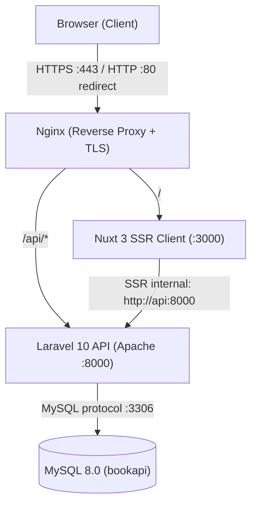
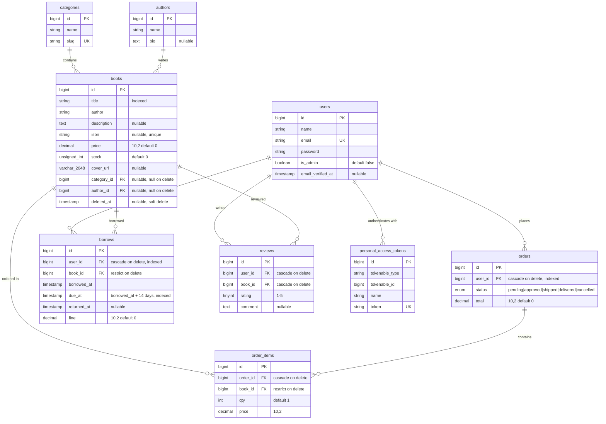
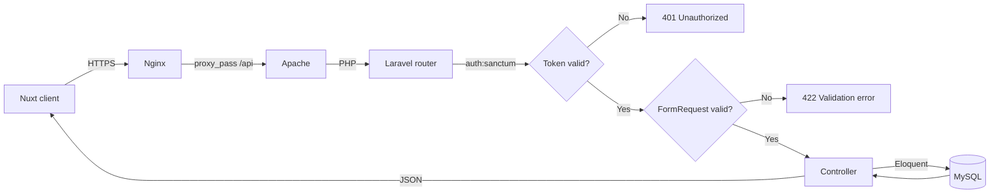
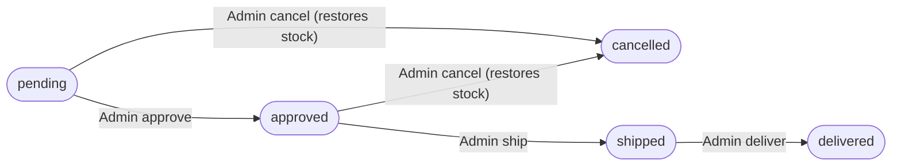
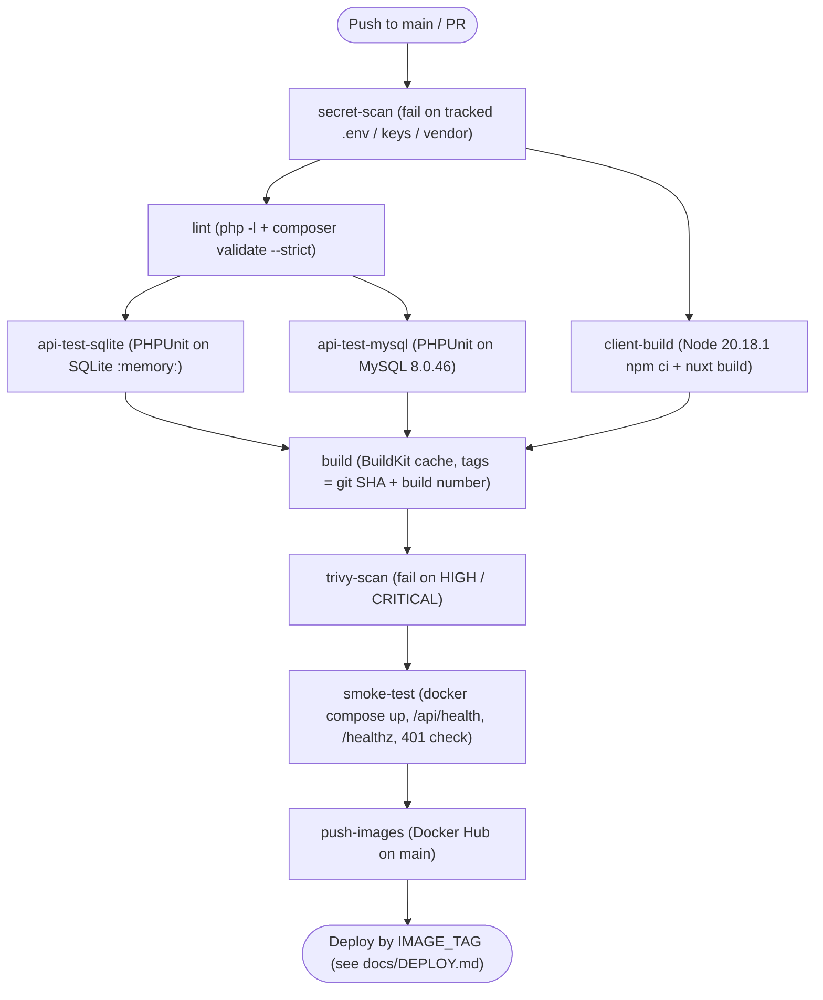
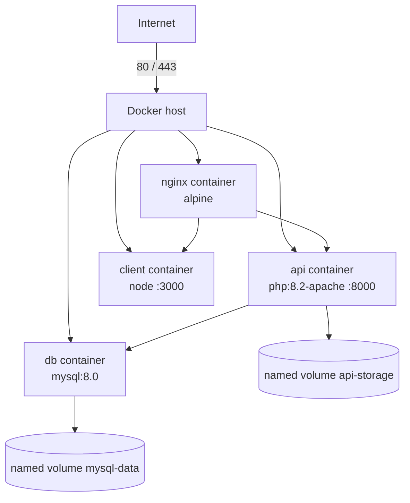

# BookHub — Architecture

This document describes the system architecture, the database schema, and the
main workflows. It is the single place to understand how the pieces fit
together before changing anything. All diagrams are Mermaid — GitHub renders
them directly in this file.

## System architecture



| Component | Responsibility |
| --------- | -------------- |
| Nginx | TLS termination, HTTP → HTTPS redirect, reverse proxy to client (`/`) and API (`/api`), `/healthz` endpoint, CSP/security headers |
| Nuxt 3 client | SSR + SPA UI for browsing/filtering books, cart, orders, borrows, reviews, login/register, and admin dashboard (`apiInternalBase` for SSR, same-origin `/api` in browser) |
| Laravel 10 API | Auth (Sanctum w/ 7-day expiry), rate limiting, validation, business rules (orders, borrows, fines, reviews), pagination/search |
| MySQL 8.0 | All persistent data — see the schema below |

Request flow for a page load: Browser → Nginx (TLS) → Nuxt client (`http://api:8000` during SSR) → Laravel API (`GET /api/books`) → MySQL → JSON/HTML back through Nginx. Subsequent browser API calls hit same-origin `/api/*` through Nginx. The API never talks to the browser directly in production; only Nginx is exposed (80/443).

## Database schema (ERD)



Notes:

- `reviews` has a unique constraint on `(user_id, book_id)` — one review per
  user per book; posting again updates the existing review.
- `books.category_id` / `books.author_id` are nullable with `nullOnDelete` —
  deleting a category or author keeps the book.
- `books` uses `SoftDeletes` (`deleted_at`), and `order_items` / `borrows`
  use `restrictOnDelete` on `book_id` so deleting a book never erases order or
  borrow history.
- `personal_access_tokens` is Laravel Sanctum's table — API tokens live here,
  not in `users`.

## User journey — browse, buy, borrow, review

```mermaid
flowchart TD
    Start([User opens BookHub]) --> Auth{Logged in?}
    Auth -- No --> Register[Register / log in<br/>POST /api/register or /api/login]
    Register --> Browse
    Auth -- Yes --> Browse[Browse books<br/>GET /api/books?search=&category_id=&author_id=]
    Browse --> Details[Open a book<br/>GET /api/books/{id}]
    Details --> Choice{Buy or borrow?}
    Choice -- Buy --> Cart[Add to cart]
    Cart --> Checkout[Checkout<br/>POST /api/orders]
    Checkout --> StockCheck{Stock sufficient?}
    StockCheck -- No --> Cart
    StockCheck -- Yes --> OrderCreated[Order created<br/>status = pending, stock decremented]
    OrderCreated --> Admin[Admin reviews order<br/>PATCH /api/orders/{id}/status]
    Admin --> Status{Status}
    Status -- approved --> Ship[Shipped]
    Status -- cancelled --> End1([Order cancelled])
    Ship --> Deliver[Delivered]
    Deliver --> Review1[Write a review]
    Choice -- Borrow --> BorrowReq[Borrow request<br/>POST /api/borrows]
    BorrowReq --> Due[Due in 14 days<br/>borrowed_at / due_at recorded]
    Due --> Return[Return book<br/>POST /api/borrows/{id}/return]
    Return --> Fine{Fine = $1 x overdue days?}
    Fine -- Yes --> PayFine[Overdue fine recorded]
    Fine -- No --> Review2[Write a review]
    PayFine --> Review2
    Review1 --> End2([Done])
    Review2 --> End2
```

Key rules enforced by the API (not just the client):

- Every write endpoint requires a Sanctum token; unauthenticated writes
  return `401` JSON (never a redirect to a missing login route).
- Book create/update/delete, category/author management, admin stats, and
  order-status changes all require an admin (`users.is_admin`, excluded from `$fillable`).
- Book create/update is validated with FormRequests — no raw `$request->all()`.
- Order creation runs in a database transaction with `lockForUpdate()` sorted by
  `book_id`: it checks stock, decrements it, computes the total from stored book
  prices, and creates the order plus items atomically.
- Order status changes follow a strict transition map (`pending → approved → shipped → delivered`,
  with `cancelled` allowed from `pending`/`approved`, restoring book stock atomically).
- Borrowing uses `lockForUpdate()`, prevents duplicate active borrows per user/book,
  and sets `due_at = borrowed_at + 14 days`. Returning computes `$1 per overdue day`
  (minimum `$1` once overdue) and restores stock atomically.
- Public book/review responses use API Resources so reviewer emails and admin flags are never exposed.

## Request lifecycle — a single API call



## Order status lifecycle



## CI/CD pipeline



Failure anywhere stops the pipeline — images are never pushed from a failing
run, and `:latest` is never used as a deploy tag. Rollback is re-deploying
the previous git-SHA tag (see `docs/DEPLOY.md`).

## Deployment topology



Only Nginx exposes host ports in production (80/443). The API, client, and
database are reachable only inside the `app-network` bridge network. Local
development adds host ports and a code bind mount via
`docker-compose.override.yml` — never use that file in staging or production.
